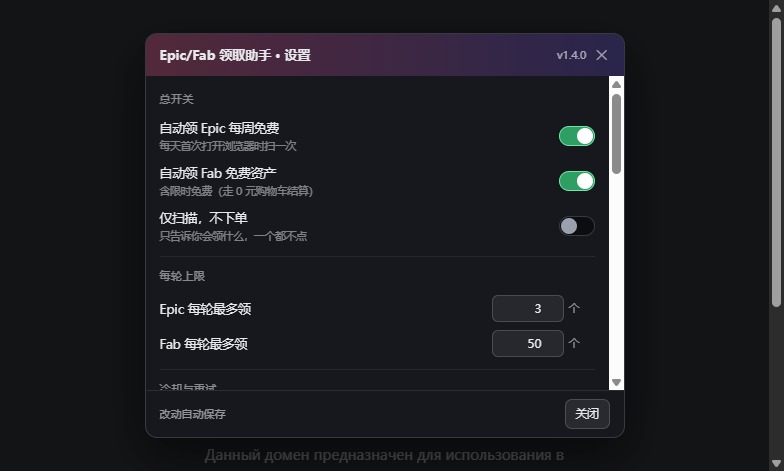

# Epic / Fab 免费领取助手

单文件 Tampermonkey 用户脚本：打开浏览器时自动扫 Epic 本周免费游戏、Fab 免费资产，能领的直接领。
跑在你自己浏览器的页面里 —— 不用服务器、不碰密码、不搬 cookie。

## 安装

1. 浏览器装 [Tampermonkey](https://www.tampermonkey.net/)（Firefox 可用 Violentmonkey）
2. 点这里安装：[**epic-fab-claimer.user.js**](https://ghfast.top/https://raw.githubusercontent.com/LHuiMeng/epic-fab-claimer-userscript/main/epic-fab-claimer.user.js)

   > 更新地址走 **ghfast.top 直通 raw**（备用：gh-proxy.com、jsDelivr）：`raw.githubusercontent.com` 在部分网络下直接 `Failed to fetch`（实测 9ms 被拒），
   > 用 raw 当 `@updateURL` 等于自动更新从来没成功过 —— 表现就是「脚本一直是老版本、也没有设置界面」。
   > jsDelivr 的 `@main` 分支文件有**最长 12 小时缓存**（实测推完半小时还发旧版），所以只当备用镜像，
   > 菜单里留了「🔁 备用镜像更新」一键切换。
3. 先在浏览器里登录一次 Epic 和 Fab —— 脚本只用你已有的登录态

> 装完**记得看面板标题**：写成 `Fab 免费资产 · v1.5.2` 才是新版。
> 如果装到的是老版本（jsDelivr 的分支缓存最长 12 小时），用固定版本链接装一次：
> `https://fastly.jsdelivr.net/gh/LHuiMeng/epic-fab-claimer-userscript@9f40b03/epic-fab-claimer.user.js`

> 脚本自带 `@updateURL`（jsDelivr），作者推新版后 Tampermonkey 会自动更新（默认每 24 小时查一次，
> 也可在扩展设置里把「检查更新」间隔调小）。手动更新：Tampermonkey 面板 → 本脚本 → 检查更新。

## 它什么时候跑（v1.3.0：打开浏览器就干活）

**不用先打开 Epic 或 Fab** —— 每天第一次落到任意网页，脚本就开始工作：

| 场景 | 行为 |
|---|---|
| 每天第一次打开浏览器（任意网站都算） | 后台静默开两个标签：Epic 免费游戏 + Fab 限时免费，扫完自己关；结果用右下角悬浮窗汇报 |
| 打开任何 Epic 商城页 | 扫本周免费游戏，有可领的在后台开领取标签 |
| 打开任何 Fab 页面 | 同源接口直接领免费 / 限时免费资产 |
| 领取标签页 | 自动点「下单 / 添加到库」→ 过条款 → 等结果；弹真人验证就高亮该标签并弹通知，停在那里等你点 |

右下角悬浮面板：本轮状态、「立即扫描本轮」（强制重试失败项）、「清日志」、「领过日志：开/关」、最近 24 条日志。

「领过日志」默认**关**：已经在库里的条目不再逐条写日志，只在收尾那行汇总成
「本轮结束 —— 新领 X 个 / 已在库 Y 个 / 无免费档 Z 个 / 失败 W 个」。
想看逐条明细就在面板点一下按钮打开（Epic 那边「已处理过，跳过」的行也归这个开关管）。

### 结果悬浮窗（不打扰你）

- 位置在右下角，只有它自己那块区域吃点击，**不遮页面、不弹模态、不抢焦点**
- 领到了 → 「Fab：领到 N 个」+ 标题
- 早就在库里 → 「Fab：M 个早就在库里（领过了）」，跟「没领到」分开说清楚
- 有失败 → 红字点名 + 一条系统通知
- 点右上角 **✕ = 今天不再提醒**（第二天自动恢复）；同一天最多主动弹 3 次，不会每开一个标签页就糊一次

## 设置面板（v1.4.0）

不用改代码，也不用开控制台。三种打开方式，**任何网站都能开**：

- Tampermonkey 图标 → 本脚本 → **⚙ 脚本设置**
- 右下角面板里的 **⚙ 设置** 按钮（Epic / Fab 页面上有）
- 面板打开后按 **Esc** 关闭；点遮罩空白处也关



改动**即时生效并自动保存**（没有"保存"按钮，省得忘点）。每项下面那行灰字是它为什么存在。

### 能调的东西

| 分组 | 项 | 默认 | 范围 | 说明 |
|---|---|---|---|---|
| 总开关 | 自动领 Epic 每周免费 | 开 | — | 每天首次打开浏览器扫一次 |
| | 自动领 Fab 免费资产 | 开 | — | 含限时免费（走 0 元购物车） |
| | 仅扫描，不下单 | 关 | — | 只报告会领什么，一个都不点 |
| 每轮上限 | Epic 每轮最多领 | 3 | 1–10 | 多开会同时加载很多结账页 |
| | Fab 每轮最多领 | 300 | 1–3000 | 想一次领完就拉到 2000+ |
| | 并发领取数 | 6 | 1–12 | 1 = 串行；6–8 大约快 5 倍，10+ 容易被限流 |
| | Fab 列表翻几页 | 40 | 1–120 | 每页 24 条；`is_free=1` 实测 **1900+** 条，全量要 80 页 |
| | 读库翻几页 | 80 | 1–200 | 库现在 1500+ 条 = 64 页；翻少了老条目会被当成「没领过」而重复领取 |
| 冷却与重试 | Epic 自动扫间隔 | 24 | 1–168 小时 | |
| | Fab 自动扫间隔 | 6 | 1–168 小时 | |
| | Epic 失败重试冷却 | 120 | 10–1440 分钟 | 免费窗口只有一周，别设太大 |
| | Fab 失败重试冷却 | 7 | 1–30 天 | |
| 汇报方式 | 显示右下角浮窗 | 开 | — | 关掉就完全静默 |
| | 每天最多主动弹 | 3 | 0–20 次 | 0 = 只在面板里看 |
| | 失败时发系统通知 | 开 | — | 成功通知不受影响 |
| | 「领过了」也逐条写日志 | 关 | — | 默认只写「新领 X / 已在库 Y」汇总行 |

### 进度怎么看（v1.7.0）

面板顶部有一条进度条 + 三行状态，每秒刷新：

```
领取 132/480（27%）
领到 45 · 失败 2 · 已在库 33 · 耗时 03:12
上次活动 1s 前
```

- **阶段名**会变：`扫描列表` → `读库` → `领取`，一眼知道现在卡在哪一步
- **上次活动 Ns 前**是心跳：超过 15 秒没动静，进度条会变橙色并提示「服务端有点慢，还在等」——不用再猜是不是死了
- 日志里明细改成**每 10 个记一条**，失败逐条记，不会被几百行刷屏

### 数据区

- **导出设置**：当前配置以 JSON 写进文本框，可直接复制备份
- **应用下面这段 JSON**：粘一段 JSON 进来即可导入；只认已知键，数值会被夹到合法区间（`"999"` → 50、`3` 分钟 → 10 分钟下限），乱七八糟的键直接丢弃
- **恢复默认**：只重置设置，不动领取历史
- **清空今日汇总**：让下次打开页面重新检查一遍
- **清空日志** / **清空领取历史**（危险操作会二次确认）

> 已在库的条目靠 Fab 库搜索识别（`/i/library/search`），所以清空历史不会导致重复占库 —— 顶多把已经有的再确认一遍。

## 为什么以前只看到一小撮（v1.5.0）

Fab 的搜索接口**每页固定 24 条**（`count` 传 60 也一样），以前只读第一页，所以「免费列表」永远是 24 个 ——
你在页面上看到左侧写着几百个免费资产，脚本却只处理了 24 个，就是这个原因。

现在两条口子各自翻页（页数可调，默认 10 页 = 240 条），去重后按「会过期的先处理」排序。

## 已在库的条目一个请求都不发（v1.5.0）

以前判断「这条领过没有」是逐条问 `/i/library/search?q=标题` —— 一个条目一次请求，几百个条目就是几百次。
现在改成**开局把整库拉一遍**（每页 24 条，`cursors.next` 翻页，默认最多 20 页），把标题归一化后放进集合，
然后每个候选条目**纯本地比对**：

- 命中 → 记「已在库」直接跳过，**不发详情、不查库、不调 add-to-library**
- 不命中 → 才去取详情、按档位判断、领取；领成功后把它加进集合，同一轮不重复

> 归一化会把 `&amp;` / `&#x27;` 还原成 `&` / `'`，再压空白转小写；库里的标题常被截断，所以先全等比、再按 24 字前缀比。

## 许可策略：专业版优先（v1.1.1）

Fab 的同一个资产常常同时挂**个人（Personal）**和**专业（Professional）**两档免费授权。
脚本的选择顺序是：

1. 免费的**专业版**优先
2. 专业版要钱（价格 ≠ 0）→ 退而领免费的个人版
3. 只有 CC-BY 等其它免费授权 → 领它

实测坑：Fab 返回的档位名是**本地化**的 —— 中文环境是 `专业` / `个人`，英文环境是
`Professional` / `Personal`。只按英文名匹配排序会全部失效，结果每次都领到数组里靠前的个人版
（这个 bug 真发生过，v1.1.1 修的就是它）。脚本现在两种语言都认。

已经用个人版领过的资产，下次扫描会额外查一次「专业版现在免费了吗」：免费就补领专业版，
仍要钱就记个时间戳、`retryDays` 天内不再问。

## 限时免费（100% 折扣）走 0 元购物车（v1.3.0）

Fab 的免费有两类，长得完全不一样：

| 类型 | 特征 | 领取方式 |
|---|---|---|
| 永久免费 | `priceTier.price === 0` | `POST /i/listings/{id}/add-to-library` |
| **限时免费** | `price` 是原价，`discountedPrice === 0`、`effectiveDiscountPercentage === 100`，带起止时间 | add-to-library 一律回 `400 Not free.` → 必须**走购物车结算** |

所以脚本现在：

1. 列表两条口子都捞：`min_discount_percentage=100`（限时免费**只在这条里出现**，`is_free=1` 搜不到它）+ `is_free=1`
2. 判断免费用 `freeUntilOf()`：永久免费 or 「现在落在折扣窗口内」，过期的、没开始的都不算
3. add-to-library 回 `Not free` 时自动改走：加购 → 读 `totalPrice.discountPrice` → **不是 0 就撤单** → `validate` → `finalize`
4. 全程只要有一处金额不是 0，立即 `DELETE` 撤掉购物车里的条目，绝不动钱

## 「领过了」怎么确认（不是靠猜）

`add-to-library` 对**已拥有**的条目照样回 204，加购物车也回 201 —— 这两个都不能当判据。

真正管用的是 Fab 库自己的搜索接口：

```
GET /i/library/search?q=<标题片段>&count=10   → 200 { results: [ { listing: { title } } ] }
```

命中就把条目记 `verified: true` 并算作「早就在库里」。拿不到结果（未登录 / 网络问题）时
**不会**冒充证据，只记「本轮没验到」。

> 别用整页 `/library` 去扫：它只渲染第一页（约 48 条），早先领过的条目扫不到，
> 会让人以为「没领过」而去重复下单（这个坑踩过）。

## 三道安全闸（防止在你账号上下错单）

1. 只处理免费接口返回的条目
2. 点之前校验页面价格：明确读到非 0 金额 → 直接放弃；读不到价格 → 只在按钮文案确实是领取类时才继续
3. 每轮 Epic 最多开 3 个、Fab 最多领 10 个；失败条目按冷却重试（Epic 120 分钟 / Fab 7 天）

## 不存任何敏感信息

- 脚本里**不含**任何 token、cookie、账号 ID、密码；仓库里也没有（本 README 就是完整说明）
- 登录态完全由浏览器自己管；需要 CSRF 时从当前页 cookie **实时读取**，读完即用，不落盘
- 本地只存两类东西：领取历史（条目标题 / 状态 / 所选档位 / 时间戳），和一条最多 200 行的运行日志
- 位置：Tampermonkey 沙箱存储的 `efc:*` 键。想清空 → 面板「清日志」，或扩展里删掉这些键

## 设置项（`efc:settings`）

> 日常别手改这段 —— 上面那个设置面板就是它的图形界面。这里只是给排障/手写配置用。

```js
{ autoEpic: true,      // 每日自动扫 Epic
  autoFab: true,       // 打开 Fab 自动领
  maxEpicPerRun: 3,    // 每轮最多开几个 Epic 领取页
  maxFabPerRun: 10,    // 每轮最多领几个 Fab 资产
  retryDays: 7,        // Fab 失败条目几天内不重试
  epicRetryMinutes: 120, // Epic 没领到的条目多久重试一次（限时免费只有一周，别睡七天）
  logOwned: false,     // 已在库（领过了）的条目要不要写日志，默认不写，免得刷屏
  toastEnabled: true,  // 右下角浮窗总开关
  toastMaxPerDay: 3,   // 每天最多主动弹几次
  notifyFail: true,    // 领取失败时发系统通知
  dryRun: false,       // true = 只扫描不领取
  epicScanHours: 24,
  fabScanHours: 6 }
```

改法：Tampermonkey 面板 → 本脚本 → 「存储」标签 → `efc:settings`。

## 限时免费的条目不会被静默丢掉（v1.2.0）

Epic 的免费游戏只有一周窗口，所以脚本对「没领到」的态度是**反复重试**，不是记一笔就睡七天：

- 领取成功的判据收紧成两条硬证据 → 订单完成文案（`Thanks for your order` / `感谢您的订单` / `下单成功`），
  或结账页按钮变成 `In Library` / `已在库`
- 成功时记 `verified: true`；历史里那些**没有 `verified` 标记的 `claimed`** 一律当作待复核，下次自动重开一遍
  （旧版把结账页常驻的 “Download the Epic Games Launcher” 文案当成成功了，于是限时免费的条目再也没碰过）
- 其它状态（`failed` / `needs-human` / `needs-login` / `skipped-paid`）按 `epicRetryMinutes`（默认 120 分钟）重试
- 免费窗口 48 小时内到期还没领到 → 顶部横幅 + 系统通知点名，不会让你以为已经处理好了
- 每条被跳过的都会在面板写清原因和「还有几分钟重试」

## 出问题怎么定位

面板日志会写出卡在哪一步：

- `Epic：60 秒没等到领取按钮（选择器可能又变了）` → Epic 改版了，提 issue 带截图，作者改 `SEL` 常量
- `Epic：页面要求登录` → 重新登录一次 Epic
- `Fab：未登录（/i/users/me → 401）` → 浏览器里的 Fab 会话没登录或过期，去 fab.com 登录一次
- `Fab：CSRF 被拒（403）` → cookie 刚刷新，脚本会等 1.5 秒重试

### Fab 的 401 与 403 不是一回事（实测对照）

同一个 `add-to-library` 请求，同一会话做了四组对照：

| 请求 | 结果 |
|---|---|
| 带正确 `X-CsrfToken` | **204** 领取成功 |
| 不带 csrf 头 | **403** `{"detail":"CSRF Failed: CSRF token missing."}` |
| 带错的 csrf | **403** `{"detail":"...CSRF token from the 'X-Csrftoken' HTTP header has incorrect length."}` |
| 会话未登录 | **401** |

所以 401 = **登录态**问题，不是 CSRF。而且 `/i/listings/search` 是公开接口，未登录也能列出免费资产，
只在写操作才 401 —— 这就是「列表拿到了、领取全失败」看起来像脚本 bug 的原因。

脚本的处理：先 `GET /i/users/me` 确认登录（未登录直接提示，不拿条目一个个撞 401）；
真撞到 401 立刻停手记 `needs-login`，登录后下次开页面自动接着领。

## 本地自测

```bash
node --check epic-fab-claimer.user.js
node test_logic.mjs     # 用 free_sample.json（真实接口快照）验免费判定、价格闸、档位排序
```

`test_logic.mjs` 用 `vm` 把脚本丢进沙箱、跳过 boot，只测纯函数：
`freeWindow`（免费窗口三层遍历）、`priceIsZero`（5 组真实文案）、`claimUrlFor`（结账 URL 三元组）、
`tierRank`（专业/个人/CC-BY 排序）。

## 已知边界

- Epic 的真人验证（hCaptcha / Turnstile）没有可编程解法，脚本只能高亮 + 通知，需要你点一下
- Fab 的 `add-to-library` 对「已拥有」也回 204，HTTP 码无法区分首次/重复，去重只能靠本地历史
- Epic 结账页的真实 DOM 依赖社区反馈修正（作者侧一开自动化浏览器就被 Turnstile 拦）

## 版本历史

| 版本 | 要点 |
|---|---|
| 1.7.1 | 读库页数默认 80（库已 1500+ 条 = 64 页），修掉「翻不够 → 已拥有被当成没领过 → 重复下单」 |
| 1.7.0 | 面板加实时进度条（阶段/百分比/已领/失败/已在库/耗时/心跳，15s 无活动变橙）；上限放宽到「列表 120 页、每轮 3000 个、并发 12」；日志明细改为每 10 条一记 |
| 1.6.3 | 主更新通道定在 ghfast.top（推送后立刻可取），备用 gh-proxy.com / jsDelivr |
| 1.6.2 | 更新通道换成 gh-proxy.com（实测推送后立刻拿到新版），另给 ghfast.top / jsDelivr 两个备用入口 |
| 1.6.1 | 更新通道换成 ghproxy 直通 raw（jsDelivr 分支缓存 12h 导致「仓库明明更新了、脚本还是老版」）；菜单加备用镜像入口 |
| 1.6.0 | Fab 领取改**并发**（`fabConcurrency`，默认 3，实测快 3 倍以上）；「打包(bundle)」类条目也改走 0 元购物车结算 |
| 1.5.2 | 启动日志直接提示设置入口在哪 |
| 1.5.1 | 更新地址从 GitHub raw 换成 jsDelivr（raw 在部分网络被墙，导致自动更新从未生效）；面板标题和启动日志都带版本号；菜单加「检查更新 / 重装」 |
| 1.5.0 | 列表**翻页**（每页 24 条，以前永远只看到 24 个）；开局**拉整库**做本地比对，已在库的条目零请求跳过；新增「列表翻几页 / 读库翻几页」设置 |
| 1.4.0 | 独立**设置面板**（菜单命令 / 面板按钮打开，13 项全可调，改完即生效）；新增浮窗总开关、每天弹窗上限、失败通知开关；设置导入导出 + 脏值归一化 |
| 1.3.2 | 「领过（已在库）」日志加开关，面板一键切换，默认关；Epic 的「已处理过，跳过」同管 |
| 1.3.1 | 跳过原因全部写明（已在库 / 当前不免费）；限时免费遇 4xx 更宽地兜底走购物车；本轮小结带计数 |
| 1.3.0 | 打开浏览器就扫（任意站点）；限时免费走 0 元购物车结算；已拥有判据改用 `/i/library/search`；角落悬浮窗汇报 + 点 ✕ 当天静音 |
| 1.2.0 | Epic 成功判据只认订单文案 / CTA 变 In Library，不再被「下载启动器」文案骗；新增 `epicRetryMinutes` |
| 1.1.1 | 许可档位改用 `slug` 判断，专业版优先（原先按本地化 `name` 匹配，中文环境下永久失效） |
| 1.1.0 | 增加 `@updateURL` 自动更新 |

## License

MIT
